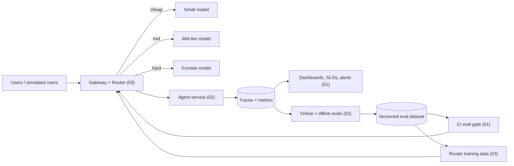

# ship-ai-projects

> You commented **SHIP**. These are the full briefs.

Three AI engineering projects that show you can run AI in production, not just call an API. Each brief covers **what to build**, **what to measure**, and **what to put in the README** so a reviewer files it in pile two.

Made by **Rasswanth** · Instagram [@skiptheline.ai](https://www.instagram.com/skiptheline.ai/)

---

## Pile one vs pile two

| Pile one (ignored) | What it actually proves | Why it gets skipped in 2026 |
|---|---|---|
| RAG chatbot over PDFs | You can follow a tutorial | Every applicant has one, and none of them say how often it's right |
| MNIST classifier | You took an intro ML course | It has nothing to do with LLM systems |
| "I fine-tuned Llama on a dataset" | You can run a training script | No baseline, no eval, no reason it beats a prompted model |
| LangChain wrapper around GPT-4 | You can call an API | Most of the code belongs to the library, not to you |
| Sentiment analysis notebook | You can use a notebook | It's never deployed, monitored, or measured against anything |

The topic isn't what separates the two piles. **A pile-one project shows that something worked once on your laptop. A pile-two project shows how well it works, what it costs, what happens when it breaks, and how you know all of that.**

## The three projects

| # | Project | In one line | What it proves you can do | Part-time effort |
|---|---|---|---|---|
| 01 | [**LLM Ops**](projects/01-llm-ops/BRIEF.md) | Build, deploy, and monitor one LLM service the way production teams do | Ship, observe, roll back, control cost | 2–3 weeks |
| 02 | [**Agent Evals**](projects/02-agent-evals/BRIEF.md) | Track an agent's accuracy and hallucinations, and make it improve from its own failures | Define correctness, build graders you can trust, improve without regressions | 3–4 weeks |
| 03 | [**Auto Routing**](projects/03-auto-routing/BRIEF.md) | Send each request to the cheapest model that will get it right | Make cost/quality tradeoffs with real baselines and honest evaluation | 2–3 weeks |

Each project folder has two files:

- `BRIEF.md`: the spec. It covers the scenario, architecture, milestones with "done when" criteria, the metrics to track, the artifacts to commit, stretch goals, red flags, and the interview questions you'll get.
- `README_TEMPLATE.md`: copy it into your repo on day one and fill it in as you build.

## How to use this repo

1. **Pick one project and go deep.** One finished project with real numbers beats three half-built ones.
2. **Read the whole brief before writing code.** The must-have milestones set the bar. Stretch goals are how you stand out.
3. **Copy the README template on day one.** If you can't fill in a section, that's your next task.
4. **Before you share it**, run the checklist in [the 90-second scan](guides/the-90-second-scan.md).
5. **Put it on your resume** using [the bullet formula](guides/resume-and-interview.md).

Already have a pile-one project? [Upgrade it](guides/upgrade-pile-one.md) instead of starting from scratch.

## Or build all three as one system

The three projects fit together. Built as one system, they tell the strongest story you can bring to an interview: *"I built an agent, run it in production, measure how often it's wrong, and cut its cost by X% without losing quality."*



Recommended order if you do all three:

1. Build a small agent and its eval harness (02, milestones M0–M3).
2. Wrap the agent in the LLM Ops stack (01).
3. Use the per-model eval results as training labels for the router (03).
4. Close the loop: production failures feed the eval set, the eval set gates deploys and retrains the router.

## Rules for every project

- **Pick a task with ground truth.** If you can't say what "correct" means, you can't measure it, and an unmeasured project lands in pile one.
- **Back every claim with a number.** Each number in the README needs a baseline, a sample size, and a short note on how it was measured.
- **Baseline everything.** "92% accuracy" tells a reviewer nothing. "92% vs 81% for the single-prompt baseline, n=300, ±3 pts 95% CI" does.
- **Show your failures.** A "What broke" section is usually the most convincing part of the README.
- **Make it run with one command**, such as `make demo` or `docker compose up`, plus an `.env.example`.
- **Stay vendor-neutral.** Call models through an OpenAI-compatible layer (e.g. LiteLLM) so you can swap providers. Frameworks are fine for plumbing, but the part you claim to have built has to be your own code.
- **Control spend.** Set hard spending limits with your providers on day one, and cache every model response to disk while developing.

## Repo map

```
ship-ai-projects/
├── README.md                     ← you are here
├── projects/
│   ├── 01-llm-ops/
│   │   ├── BRIEF.md
│   │   └── README_TEMPLATE.md
│   ├── 02-agent-evals/
│   │   ├── BRIEF.md
│   │   └── README_TEMPLATE.md
│   └── 03-auto-routing/
│       ├── BRIEF.md
│       └── README_TEMPLATE.md
├── guides/
│   ├── the-90-second-scan.md     ← what reviewers look at + ship checklist
│   ├── resume-and-interview.md   ← resume bullets, interview walkthrough, post template
│   └── upgrade-pile-one.md       ← turn an old project into a pile-two project
└── RESOURCES.md                  ← papers, tools, datasets (all links checked)
```

## FAQ

**Do I need a GPU?**
No. All three projects work with API models. Self-hosting with vLLM is an optional track in LLM Ops; if you take it, rent a GPU by the hour.

**How much will API calls cost?**
It depends on which models you use and how big your dataset is. Use small models for most of development, cache every response, and set a hard budget cap before you start. Paying to re-run the same prompt twice is a bug.

**Can I use LangChain / LangGraph / CrewAI / another framework?**
Yes, for the agent loop and other plumbing. But the part you claim to have built has to be your own code. In Agent Evals, that's the dataset, the graders, and the analysis. In Auto Routing, it's the router and its evaluation.

**Python only?**
The briefs assume Python. TypeScript works just as well.

**Can I fork this and post my build?**
Yes. Tag [@skiptheline.ai](https://www.instagram.com/skiptheline.ai/) and I'll take a look.

## License

[CC BY 4.0](LICENSE). Use, remix, and share it with attribution.
