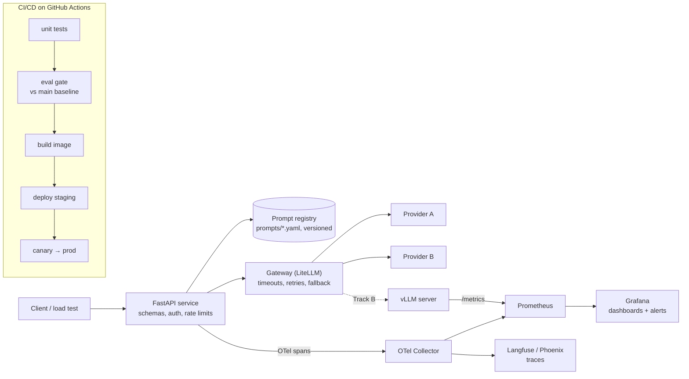

# 01 — LLM Ops: run one LLM service like production

> **The sentence you want a reviewer to read:**
> "I took an LLM feature from a notebook to a deployed service. It has versioned prompts, an eval gate in CI, end-to-end tracing, latency and cost SLOs, provider failover, and a rollback I actually tested. Here are the numbers."

## What this project proves

- You can **ship and operate** an LLM system, not just prototype one.
- You treat prompts, model choices, and configs as **versioned artifacts** that are tested before release.
- You know **what to monitor** and can explain your p95 latency, error budget, and cost per request.
- You've **tested failure**, not just the happy path.

---

## 1. Pick the workload

The workload has to produce **structured output**, so correctness can be checked by code, and it needs at least **200 labeled examples**. Choose one:

| Option | Input → Output | Data | Why it works |
|---|---|---|---|
| **A. Support ticket triage API** (default) | ticket text → `{category, priority, product, summary, draft_reply}` | [Bitext customer support dataset](https://huggingface.co/datasets/bitext/Bitext-customer-support-llm-chatbot-training-dataset) + 200 tickets you hand-label for priority | Classification fields are graded exactly. A judge only grades `draft_reply` |
| **B. Document extraction API** | receipt/invoice → line items + totals as JSON | [CORD v2 receipts](https://huggingface.co/datasets/naver-clova-ix/cord-v2) | Field-level exact match, and totals have to add up |
| **C. Your Project 02 agent** | user task → agent result | Your eval set from 02 | Best choice if you're doing all three projects |

## 2. Pick your track

- **Track A — API models (default).** Put a gateway in front of **at least 2 providers** so failover is real.
- **Track B — Self-hosted.** Serve an open-weights model with **vLLM** on a rented GPU and keep an API model as the fallback. Choose this track if you're aiming for platform or infra roles.

## 3. Target architecture

---

## 4. Milestones

Every milestone ends with a **"done when"** you can demo or point to in the repo.

### M0 — Baseline (start here)
- Get the feature working locally against one model.
- Build a **golden set** of at least 200 labeled examples and split it into `dev` (iterate on this) and `test` (gate on this; never tune prompts on it).
- Write a `make eval` that prints accuracy per field, schema-valid rate, p50/p95 latency, and cost per request.

**Done when:** one command prints a baseline table and you've saved it as `results/baseline.json`.

### M1 — Package it like a service
- FastAPI with Pydantic request/response models, plus `/healthz` and `/readyz` endpoints.
- Keep prompts **out of Python strings**. Use `prompts/triage/v3.yaml` (template + model + params) with explicit version IDs.
- Every response and log line carries `prompt_version`, `model`, and `git_sha`.
- Docker image, secrets loaded from env, and an `.env.example` in the repo.

**Done when:** `docker compose up` brings up the service, and every response tells you exactly which prompt and model produced it.

### M2 — Reliability through a gateway
- Route every model call through a gateway (LiteLLM SDK or proxy).
- **Timeouts** on every call.
- **Retries** with exponential backoff and jitter, only on retryable errors (429, 5xx, timeouts). Never retry 400s, and honor `Retry-After` when it's sent.
- **Fallback** to a second provider/model, plus a simple **circuit breaker** so a dead provider isn't hammered.
- **Validate structured output**. If parsing fails, do one repair retry, then return a typed error.
- **Guardrails**: caps on input tokens and `max_tokens`, plus per-client rate limits.

**Done when:** you break the primary provider (e.g. with a bad key or blocked host), requests still succeed through the fallback, and you can see the fallback happen in traces.

### M3 — Observability
- **Traces**: OpenTelemetry with one span per request and child spans per LLM call. Use the GenAI attributes (`gen_ai.request.model`, `gen_ai.usage.input_tokens`, `gen_ai.usage.output_tokens`, `gen_ai.response.finish_reasons`) plus your own `app.prompt_version`. Export to Langfuse or Phoenix.
  - Note: the [OTel GenAI conventions](https://github.com/open-telemetry/semantic-conventions-genai) are still in *Development* status and attribute names have changed during 2026. Pin the version you follow and note it in the README.
- **Metrics** in Prometheus: RPS, p50/p95/p99 latency, TTFT if you stream, tokens in/out, cost per minute, error rate **by class** (rate-limit, timeout, provider-5xx, schema-fail), fallback rate.
- **A Grafana dashboard** committed as JSON in `ops/grafana/`.
- **Two alerts at minimum**: SLO burn rate and cost spike.

**Done when:** you can open a single slow request in the trace view and explain where the time went.

### M4 — CI/CD with an eval gate
- On every PR, run unit tests, then the eval on `test` (or a fast stratified subset on PRs and the full set nightly).
- Compare against the baseline from `main`. **Fail the PR** if accuracy drops more than your threshold (e.g. 2 points), or if p95 latency or cost per request regress by more than your threshold (e.g. 15%).
- Post the comparison table as a PR comment or job summary.
- On merge to `main`: build and push the image, then deploy to staging automatically.

**Done when:** you have a link to a PR that the eval gate **blocked**, with the table explaining why.

### M5 — Rollout and rollback
- Send a **canary** share of traffic (e.g. 10%) to the new prompt/model version using weighted routing or a feature flag.
- Compare the canary against stable on live metrics, and set rollback criteria **before** you deploy.
- Make rollback one command or automatic, with no rebuild. Rolling back a prompt should be a config change.

**Done when:** you've recorded a drill in which a change passes CI but fails the canary (e.g. a model swap that blows the latency SLO) and gets rolled back.

### M6 — Load, cost, and capacity
- Load test with k6 or Locust at increasing RPS until you find where latency degrades and where 429s start.
- Build a cost model: cost per request, **cost per 1,000 successful requests**, and a monthly projection at a stated traffic level.
- Find out what dominates cost (it's usually input tokens: system prompt plus context) and run one experiment that reduces it, such as prompt trimming, provider prompt caching, or a smaller model for one field.

**Done when:** the README has a load-test table and a before/after cost table.

### M7 — Runbook and postmortem
- `RUNBOOK.md`: for each alert, what it means, what to check first, and how to mitigate it.
- `postmortems/001-*.md`: a blameless postmortem of a real incident from your build (there will be one). Cover the timeline, impact, root cause, and what you changed.

**Done when:** someone else could carry the pager for your service using only the repo.

---

## 5. What to measure

| Metric | Definition | Why a reviewer cares |
|---|---|---|
| Task accuracy | Per-field exact match on `test` (judge score for free-text fields) | Shows the service does its job |
| Schema-valid rate | % of responses that parse into the response model on the first try | The most common real-world failure for structured output |
| Availability / success rate | % of requests returning a valid result | The core SLO |
| p50 / p95 / p99 latency | End-to-end at the API, measured under load | LLM latency has a long tail, and p95 is what users notice |
| TTFT | Time to first token (streaming) | Perceived speed |
| Error rate by class | 429 / timeout / 5xx / schema-fail, as % of requests | Shows you understand failure modes |
| Fallback rate | % of requests served by the secondary provider | Tells you whether the primary is healthy |
| Cost per request and per 1k successes | Using actual token usage × dated price table | Shows you think about money |
| Eval gate catches | Count of PRs blocked, with links | Proof the gate works |

**Example SLOs** (set your own from your baseline, then defend them):
- 99% of requests return a schema-valid result over 7 days.
- p95 latency under 4 s at 5 RPS.
- Cost per 1,000 successful requests under $X.

The error budget is what makes these useful: at 99% availability you're allowed to fail 1% of requests. Alert on how fast you're **burning** that budget, not on single errors. See the [SRE workbook on SLO alerting](https://sre.google/workbook/alerting-on-slos/).

---

## 6. Artifacts to commit

- [ ] `README.md` filled in from the [template](README_TEMPLATE.md), with headline numbers above the fold
- [ ] Architecture diagram (Mermaid in the README is fine)
- [ ] `results/` containing the baseline and current eval JSON, plus load-test output
- [ ] `ops/grafana/*.json` dashboard and a screenshot under real load
- [ ] A link to a CI run where the eval gate blocked a PR
- [ ] `RUNBOOK.md` and at least one postmortem
- [ ] A 2-minute demo video of the failover or canary-rollback drill (a screen recording is enough)

## 7. Stretch goals (pick one or two)

- **Semantic cache**: measure the hit rate **and** the false-hit rate (cached answers that were wrong for the new query). A cache with no quality measurement is a liability.
- **Self-host break-even** (Track B): monitor KV-cache usage, queue time, and TTFT from vLLM's `/metrics`, then calculate the request volume at which self-hosting becomes cheaper than the API.
- **Shadow deployment**: mirror production traffic to a candidate model and compare outputs offline before switching.
- **Input drift monitoring**: embed incoming requests, compare the weekly distribution to your golden set, and alert on drift.
- **PII redaction** before the model call, with the latency it adds measured.
- **Kubernetes** (kind/k3d) with autoscaling on queue depth instead of CPU.

## 8. Red flags (these put you back in pile one)

- "Deployed" means a Streamlit or Gradio share link.
- Dashboards with no SLOs, or screenshots of an empty tracing UI.
- Retrying every error, 400s included.
- Prompts hardcoded in Python, with no version on the output.
- API keys anywhere in git history (scan with `gitleaks` before going public).
- A load test with no numbers in the README.
- An eval step in CI that has never failed a build.

## 9. Interview questions you'll get

1. **"CI passed, but accuracy dropped 6 points in production. How?"** The test set doesn't match production traffic. Fix it by sampling production traces into the eval set and gating on canary metrics too, not only offline evals.
2. **"Your provider starts returning 429s at peak. Walk me through it."** Backoff with jitter, honor `Retry-After`, fall back, apply per-client limits, queue or shed load, then look into reserved capacity.
3. **"What does a request cost, and what drives it?"** Know your input/output token split. Prompt caching, context trimming, or a smaller model for easy fields are the usual levers.
4. **"How do you roll back a bad prompt?"** It's a versioned artifact behind a config flag, so rollback needs no rebuild or redeploy.
5. **"Why p95 and not average latency?"** Output length varies, so LLM latency has a long tail. The average hides the slow requests users actually notice.
6. **"When would you self-host instead of using an API?"** Volume and break-even math, latency control, and data residency. Show your calculation.

## 10. Suggested stack (vendor-neutral)

| Layer | Default | Alternatives |
|---|---|---|
| Service | FastAPI + Pydantic | Litestar |
| Gateway | [LiteLLM](https://github.com/BerriAI/litellm) (SDK or proxy) | Portkey, Bifrost, OpenRouter, Envoy AI Gateway |
| Tracing | OpenTelemetry → [Langfuse](https://langfuse.com/docs) | [Arize Phoenix](https://github.com/Arize-ai/phoenix), Opik, Grafana Tempo |
| Metrics / alerts | Prometheus + Grafana | SigNoz, OpenObserve |
| Eval in CI | pytest + your own harness | [promptfoo](https://github.com/promptfoo/promptfoo), DeepEval |
| Load test | [k6](https://grafana.com/docs/k6/latest/) | Locust |
| Deploy | Docker → Fly.io / Render / Cloud Run | Kubernetes (kind/k3d), Modal |
| Self-host (Track B) | [vLLM](https://docs.vllm.ai/) | SGLang, Ollama (local dev only) |

Further reading for this project is in [RESOURCES.md](../../RESOURCES.md#llm-ops).
