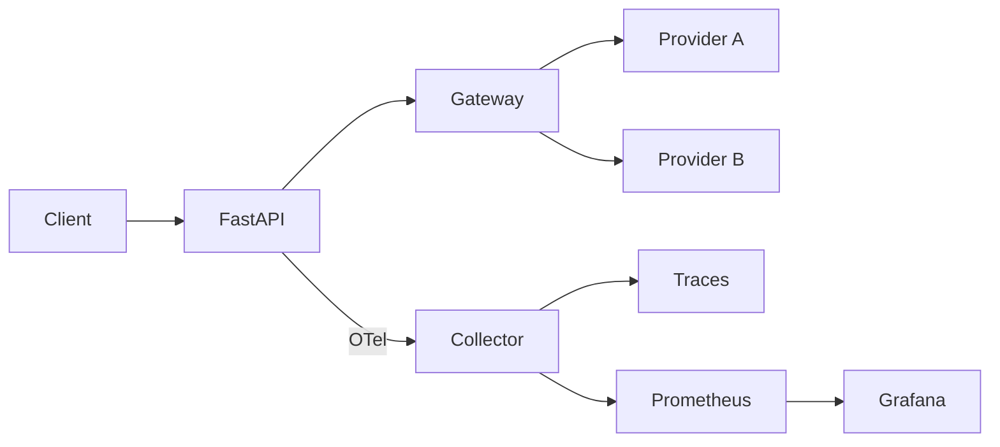

<!--
  README template for Project 01: LLM Ops.
  Copy this into your repo as README.md on day one and fill it in as you build.
  Replace every <placeholder> and XX. Delete these comments when you're done.
  Rule: every number needs a baseline, a sample size, and a note on how you measured it.
-->

# <Service name>: <one line on what it does>

> A production-style LLM service for **<task, e.g. support ticket triage>**. It has versioned prompts, an eval gate in CI, OpenTelemetry tracing, SLO-based alerting, multi-provider failover, and canary rollouts.


## Results

| Metric | Baseline (M0) | Current | SLO |
|---|---|---|---|
| Task accuracy (test, n=XX) | XX% | XX% (±X pts, 95% CI) | ≥ XX% |
| Schema-valid on first try | XX% | XX% | ≥ 99% |
| p95 latency @ X RPS | X.X s | X.X s | < X s |
| Cost / 1k successful requests | $X.XX | $X.XX | < $X |
| Availability (7-day) | n/a | XX.X% | ≥ 99% |

- **Eval gate:** blocked XX PRs; example: <link to blocked PR>.
- **Failover drill:** with the primary provider down, XX% of requests still succeeded through the fallback, and p95 went from X.X s to X.X s. <link to 2-min video>
- **Cost cut:** <what you changed> reduced cost/request by XX% with no accuracy change (Δ = X pts, within noise).

<!-- Hero image: Grafana dashboard under load. -->


## Architecture



<!-- 3–6 bullets explaining the flow. Link each one to the file that implements it. -->
- Prompts are versioned YAML in [`prompts/`](prompts/). Every response carries `prompt_version`, `model`, and `git_sha`.
- Reliability (timeouts, retries on 429/5xx only, fallback, circuit breaker): [`app/llm.py`](app/llm.py)
- Eval gate: [`.github/workflows/ci.yml`](.github/workflows/ci.yml) compares against `main` and fails on > X pt accuracy drop or > XX% latency/cost regression.

## How I measured

- **Dataset:** XX labeled examples from <source>, split dev/test = XX/XX. Prompts were tuned on dev only.
- **Accuracy:** per-field exact match; `draft_reply` graded by an LLM judge validated against XX of my own labels (agreement XX%).
- **Latency/cost:** k6 at 1/5/10/20 RPS for X minutes each; cost from actual token usage × price table dated <YYYY-MM-DD>.
- **Noise:** two identical eval runs differed by X pts, so I treat changes smaller than that as noise.

### Load test

| RPS | p50 | p95 | Error rate | Notes |
|---|---|---|---|---|
| 1 | | | | |
| 5 | | | | |
| 10 | | | | 429s start here |
| 20 | | | | |

## What broke (and what I learned)

<!-- The most convincing section. 2–3 short stories: symptom → how I found it (link the trace/graph) → root cause → fix → what I monitor now. -->
1. **<Incident title>.** <Symptom>. I found it via <trace/alert>. The root cause was <...>. I fixed it by <...>. Postmortem: [`postmortems/001-...md`](postmortems/)
2. ...

## Key decisions and tradeoffs

| Decision | Alternatives considered | Why |
|---|---|---|
| LiteLLM as the gateway | Direct SDKs, Portkey | One OpenAI-compatible interface across providers; fallback config |
| Langfuse for traces | Phoenix, Tempo | <your reason> |
| Canary by header/weight | Blue-green | <your reason> |

## Run it

```bash
git clone https://github.com/<you>/<repo> && cd <repo>
cp .env.example .env   # add provider keys
make up                # service + collector + Prometheus + Grafana + tracing UI
make eval              # golden-set eval → results/latest.json
make load              # k6 load test
```

## Repo layout

```
app/            service, schemas, gateway client
prompts/        versioned prompt configs
evals/          golden set, graders, eval runner
ops/            OTel collector, Prometheus rules, Grafana dashboards, k6 scripts
postmortems/    incident write-ups
RUNBOOK.md      alert → diagnosis → mitigation
```

## Limitations and next steps

- <Honest limitation, e.g. "golden set is synthetic-heavy; next step is sampling real traffic">
- <Next step>
