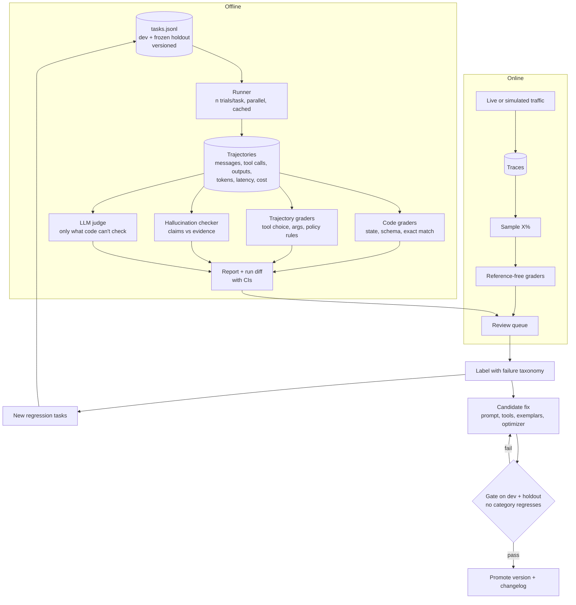
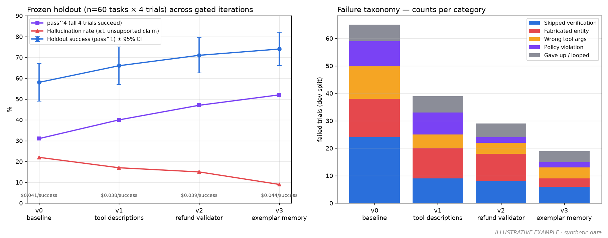

# 02 — Agent Evals: measure an agent's accuracy and hallucinations, and make it improve every iteration

> **The sentence you want a reviewer to read:**
> "I built a tool-using agent and the system that grades it: XX tasks, deterministic graders plus an LLM judge I validated against my own labels (κ = 0.XX), trajectory-level scoring, and pass^k reliability. A failure → dataset → fix loop raised success on a frozen holdout from XX% to XX% over N iterations, with no category regressing."

## What this project proves

- You can **define correctness** for a non-deterministic, multi-step system.
- You build **graders you can trust**, and you can show the evidence that they're right.
- You do **error analysis**: you read traces, name failure modes, and fix the biggest one first.
- You **don't fool yourself**. You account for run-to-run noise, test-set leakage, and judge bias.
- You can make a system **improve from its own failures** without breaking what already worked.

> The agent is **not** the point. Keep it simple. The eval system is the project.

---

## 1. Build a small agent with verifiable outcomes

The agent needs 4–8 tools, has to take multiple steps, and must run in an environment where you can **check the result with code**. Choose one:

| Option | Agent | How you grade it | Notes |
|---|---|---|---|
| **A. Customer support agent** (recommended) | Handles orders, refunds, address changes over a SQLite DB while following a written policy doc | Final **DB state** matches expected state, plus policy-rule checks on the trajectory | Same design as [τ²-bench](https://github.com/sierra-research/tau2-bench). You can borrow its domains or build your own |
| **B. Analytics / text-to-SQL agent** | Answers business questions over a public DB ([Chinook](https://github.com/lerocha/chinook-database), [BIRD](https://bird-bench.github.io/)) | **Execution match**: the agent's result set equals the reference query's result set | Very cheap to grade, and wrong-but-plausible answers are common, which gives you good material |
| **C. Research agent with citations** | Answers questions over a fixed corpus, e.g. a few companies' 10-Ks from [SEC EDGAR](https://www.sec.gov/edgar/search/) | Answer vs reference, **plus citation grounding** | Most hallucination-heavy, but the graders are harder. Pick this if you want hallucination to be the headline |

Write the agent as a plain loop: model call → tool calls → tool results → repeat, with a max-step limit. Use any framework you like for plumbing, but you have to be able to log **every step**.

## 2. Target architecture



---

## 3. Milestones

### M0 — Agent + 50 tasks
- Get the agent working end to end.
- Write **50 tasks** in `tasks.jsonl`. Each one has `id`, `input`, `expected` (state assertions or a reference answer), `tags` (category, difficulty), and `split`.
- Mix in easy, hard, and **adversarial** tasks: ambiguous requests, requests the policy says to refuse, tasks where a tool returns an error.
- **Freeze a holdout split now** (at least 30% of tasks). Never use it to write prompts, pick exemplars, or tune the judge.

**Done when:** `make eval` runs all tasks once and prints the success rate.

### M1 — Runner and trajectory logging
- Run each task **n ≥ 4 times** in parallel, with response caching and a fixed config (model, temperature, prompt version).
- Log the full trajectory per trial as JSONL or OTel traces (Langfuse/Phoenix): messages, tool calls with args, tool outputs, tokens, latency, cost.
- Run the full suite **twice with nothing changed** and record the **flip rate**, the share of (task, trial) outcomes that changed. That's your noise floor.

**Done when:** you can say, for example, "identical runs disagree on X% of outcomes, so a change smaller than Y pts isn't real."

### M2 — Layered graders
Use cheap and certain checks wherever you can. Use LLM judges only where you have to.

1. **Code graders**: final state assertions, output schema, exact or execution match.
2. **Trajectory graders**:
   - **Tool selection**: did it call the right tools? Measure precision and recall against a reference set, or against rules.
   - **Argument correctness**: are the args valid against the tool schema, and do they reference real entities?
   - **Policy rules** written as code, e.g. "must look up the order before issuing a refund", "never refund more than the order total", "must confirm before cancelling".
   - **Efficiency**: steps taken vs the reference, and repeated identical calls (loops).
3. **LLM judge**: only for qualities code can't check, such as tone, helpfulness, or whether the agent explained a refusal. Use binary pass/fail with a written rubric and a short reason. Avoid 1–10 scales.

**Done when:** each trial gets a per-grader breakdown, and the report shows success by category.

### M3 — Hallucination detection
Define hallucination **operationally**, so it can be counted:

- **Unsupported claim**: a factual statement in the final answer that no tool output or retrieved evidence in the trajectory supports.
- **Contradicted claim**: a statement that conflicts with the evidence.
- **Fabricated entity**: an ID, name, number, or URL in the answer or in tool args that never appeared in any tool output or in the user's input. This check is **deterministic**: extract the entities and diff them against the trajectory.
- **Fabricated action**: the agent says it did something ("I've issued your refund") that has no matching tool call. Also deterministic.

Pipeline: split the final answer into **atomic claims** (the [FActScore](https://arxiv.org/abs/2305.14251) idea), then label each claim as `supported`, `contradicted`, or `unsupported` against the trajectory's evidence using an NLI model or a judge.

**Done when:** the report shows the response-level hallucination rate, the claim-level unsupported rate, and the fabricated-entity and fabricated-action rates, each with examples you can click through to.

### M4 — Validate your judges (the step most people skip)
- Hand-label **100–200 trials** yourself with a written rubric: pass/fail per judged criterion and per-claim support.
- Split the labels into `judge-dev` (for tuning the judge prompt) and `judge-test` (for reporting only).
- Report the judge's **TPR and TNR** (it catches real failures; it doesn't flag good outputs) and **Cohen's κ** against your labels on `judge-test`.
- Iterate on the judge prompt, model, or few-shot examples until agreement is acceptable, and say what "acceptable" means to you and why.
- Check for **position and verbosity bias** in at least one judge by swapping order or padding answers.

**Done when:** the README states, for example, "Hallucination judge: TPR 0.XX, TNR 0.XX, κ = 0.XX on n = XX held-out human labels."

### M5 — Error analysis and failure taxonomy
- Read **at least 100 failed trajectories**. Write a free-text note on each (open coding), then group the notes into **5–10 failure categories** (axial coding). For example: wrong tool, wrong args, skipped verification step, hallucinated fact, policy violation, gave up early, looped, misread the user.
- Count failures by category and sort. The top category is your next fix.

**Done when:** `docs/failure-taxonomy.md` has categories, counts, and 2 linked example traces per category.

### M6 — The continuous learning loop
In this project, "continuous learning" means **the system gets better from its own failures in a controlled, measured way**. It does **not** mean updating weights online. One iteration looks like this:

1. **Collect** failures from offline runs and from online traces flagged by reference-free graders (sample X% of live or simulated traffic).
2. **Triage** each failure into a taxonomy category, through a review queue (Langfuse/Phoenix annotation queues, or a simple CLI).
3. **Grow the dataset**: turn each *new* failure mode into at least one regression task, deduplicated by embedding similarity. Bump the dataset version (`v1 → v2`).
4. **Fix** the top category with one of these:
   - Prompt or **tool-description** changes. Tool descriptions are often the biggest lever.
   - **Exemplar memory**: store successful trajectories and retrieve the most similar ones as few-shot examples at runtime.
   - **Automatic prompt optimization** against the dev split, e.g. [DSPy](https://dspy.ai/) optimizers such as MIPROv2 or GEPA.
   - A **validator/guardrail** step, such as checking refund amounts against the order total before the tool call.
   - *(Stretch)* Fine-tune a small model on successful trajectories, then route between it and the base model (see Project 03).
5. **Gate**: re-run dev and the frozen holdout. Promote only if the improvement is significant (see §5) **and** no category regresses past your threshold.
6. **Record** a `CHANGELOG.md` entry: what changed, the metric deltas, and the dataset version.

**Leakage rule:** nothing derived from the holdout may be used in a fix. That includes exemplars, optimizer training data, and judge prompts. If you break this rule, your improvement chart means nothing.

**Done when:** you've run **at least 3 iterations** and have a chart of holdout success, hallucination rate, and cost per success per iteration, plus a stacked bar of failure categories shrinking.

**What that chart should look like** (illustrative, synthetic data). Every iteration is a gated change, holdout success carries a CI, and the failure-taxonomy bars show which fix removed which category:



### M7 — Online evals (simulated is fine)
- Run a **simulated user** (an LLM given a persona and a goal, as in τ-bench) against the deployed agent to generate traffic.
- Score sampled traces with reference-free graders: hallucination checker, policy rules, tool errors, loop detection.
- Build a dashboard with these metrics over time and an alert when the hallucination rate exceeds a threshold.

**Done when:** a regression you deliberately introduce (e.g. a degraded tool description) shows up on the online dashboard and lands in the review queue.

---

## 4. What to measure

| Metric | Definition | Notes |
|---|---|---|
| **Success rate** | % of trials where all outcome graders pass | Report per category and per difficulty |
| **pass^k** | Probability that **all k** of k trials succeed | Reliability. What a customer-facing agent needs ([τ-bench](https://arxiv.org/abs/2406.12045)) |
| pass@k | Probability that **at least one** of k trials succeeds | Shows potential, not reliability. Report it next to pass^k to show the gap |
| Tool selection P/R | Precision/recall of tools called vs the reference set | Per tool, to find confusing tool descriptions |
| Arg validity / correctness | % of calls with schema-valid args / correct args | |
| Efficiency | Steps ÷ reference steps; loop rate | Cost and latency driver |
| **Hallucination rate** | % of responses with ≥1 unsupported or contradicted claim | Response-level headline |
| Claim-level unsupported rate | Unsupported claims ÷ total claims | More sensitive than the response-level rate |
| Fabricated entity / action rate | % of trials with an invented ID/value, or a claimed action with no tool call | Deterministic, so cheap to run on every trace |
| Policy violation rate | % of trials breaking at least one policy rule | |
| **Judge agreement** | TPR, TNR, Cohen's κ vs human labels on held-out labels | Shows reviewers your other numbers can be trusted |
| Cost / successful task, p95 latency | Total cost ÷ successes; per-task latency | |
| Flip rate | % of outcomes that change between identical runs | Your minimum detectable effect |

### Computing pass^k and pass@k

For a task with `n` trials and `c` successes, average over tasks:

```python
from math import comb

def pass_hat_k(n: int, c: int, k: int) -> float:
    """P(all k sampled trials succeed). τ-bench's pass^k."""
    return comb(c, k) / comb(n, k)

def pass_at_k(n: int, c: int, k: int) -> float:
    """P(at least one of k sampled trials succeeds)."""
    return 1 - comb(n - c, k) / comb(n, k)
```

## 5. Statistics (enough to not fool yourself)

- **Report confidence intervals.** Bootstrap over tasks, resampling tasks rather than trials. Sample sizes are small here: at 100 tasks and ~50% success, the 95% CI is roughly **±10 pts**.
- **Compare versions with paired tests**: the same tasks under both versions, using McNemar's test on per-task success or a paired bootstrap on the difference.
- **Compare against your flip rate.** If a change is smaller than the run-to-run noise from M1, call it noise.
- **Don't cherry-pick.** Fix the task set and trial count before you look at results.

## 6. Artifacts to commit

- [ ] `README.md` with the improvement chart above the fold
- [ ] `evals/tasks.jsonl` (versioned), graders, runner, and `make eval`
- [ ] `docs/failure-taxonomy.md` with counts and example traces
- [ ] `docs/judge-validation.md` with the agreement table and confusion matrix
- [ ] `CHANGELOG.md` with one entry per improvement iteration
- [ ] Run reports in `results/` (one per version) and a diff between two of them
- [ ] A 2-minute video: a failing trace → its taxonomy label → the fix → the gate passing

## 7. Stretch goals

- **Run your agent on τ²-bench** as an external sanity check alongside your own suite.
- **Cost-aware evals**: chart success against cost per task for 2–3 models, which feeds directly into Project 03.
- **Eval CI**: run the suite on every PR and post the diff table as a comment. This shares infrastructure with Project 01.
- **Judge ensembling**: compare a single strong judge against a panel of smaller judges on agreement and cost.
- **Adversarial task generation**: use an LLM to generate variants of failing tasks, review them by hand, and add them to the set.

## 8. Red flags (these put you back in pile one)

- Only LLM-as-judge scores, and the judge was **never validated** against human labels.
- "94% accuracy" on 20 hand-picked examples, run once.
- Tuning prompts while looking at the test set. Here that means the holdout.
- Grading only the final answer, never the trajectory.
- A "hallucination score" taken from a library with no definition of what it counts.
- "Continuous learning" that means appending user feedback to the system prompt with no gate.
- No examples. Reviewers want to click through to a failing trace.

## 9. Interview questions you'll get

1. **"How do you know your judge is right?"** Human labels, a held-out split for the judge, TPR/TNR and κ, and bias checks.
2. **"Success went from 72% to 75%. Is that real?"** Compare it to the flip rate and CI, run a paired test, and run more trials.
3. **"pass@k vs pass^k: which matters here, and why?"** For a customer-facing agent, pass^k. The user gets one attempt.
4. **"How do you evaluate an agent when there's no ground truth?"** Reference-free graders (grounding, policy, fabricated entities), pairwise comparison, and human review sampled into a labeled set.
5. **"How do you stop the eval set from going stale or getting overfit?"** Feed production failures in, keep a frozen holdout, version the dataset, and refresh periodically.
6. **"What was your biggest failure category, and what fixed it?"** Have a specific answer, with a number.

## 10. Suggested stack (vendor-neutral)

| Layer | Default | Alternatives |
|---|---|---|
| Agent loop | Plain Python + [LiteLLM](https://github.com/BerriAI/litellm) tool calling | OpenAI Agents SDK, PydanticAI, LangGraph |
| Eval harness | **Your own** (runner, graders, report). This is the project | [Inspect AI](https://inspect.aisi.org.uk/), [DeepEval](https://github.com/confident-ai/deepeval), [promptfoo](https://github.com/promptfoo/promptfoo) |
| Traces, datasets, annotation | [Langfuse](https://langfuse.com/docs) | [Arize Phoenix](https://github.com/Arize-ai/phoenix), Opik |
| Optimization | [DSPy](https://dspy.ai/) | Hand iteration (fine, if it's measured) |
| Reference benchmarks | [τ²-bench](https://github.com/sierra-research/tau2-bench) | [BFCL](https://gorilla.cs.berkeley.edu/leaderboard.html) for function calling |
| Stats | `scipy`, `numpy` (bootstrap, McNemar via `statsmodels`) | |

Further reading for this project is in [RESOURCES.md](../../RESOURCES.md#agent-evals).
