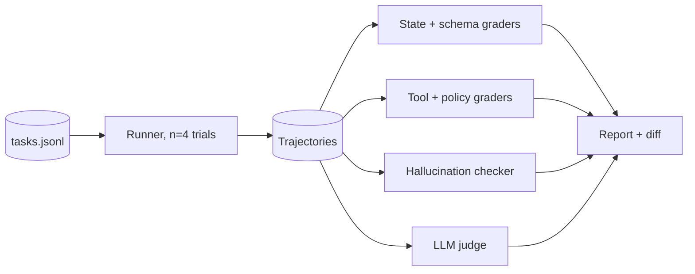

<!--
  README template for Project 02: Agent Evals.
  Copy this into your repo as README.md on day one and fill it in as you build.
  Replace every <placeholder> and XX. Delete these comments when you're done.
  Rule: every number needs a baseline, a sample size, and a note on how you measured it.
-->

# <Agent name> + Eval System

> A tool-using **<domain, e.g. customer support>** agent and the system that measures it: deterministic and trajectory graders, a validated hallucination judge, pass^k reliability, and a failure → dataset → fix loop gated on a frozen holdout.

## Results

<!-- Hero image: holdout success and hallucination rate across iterations. -->


| Version | Dataset | Holdout success (95% CI) | pass^4 | Hallucination rate | Policy violations | Cost / success |
|---|---|---|---|---|---|---|
| v0 baseline | v1 (XX tasks) | XX% (±X) | XX% | XX% | XX% | $X.XXX |
| v1 <fix name> | v2 | XX% (±X) | XX% | XX% | XX% | $X.XXX |
| v2 <fix name> | v3 | XX% (±X) | XX% | XX% | XX% | $X.XXX |

- **Noise floor:** identical runs flip X.X% of outcomes, so I treat changes under X pts as noise. v0 → v2 is significant (McNemar p = 0.0X, n = XX paired tasks).
- **Judge validation:** the hallucination judge scored TPR 0.XX, TNR 0.XX, κ = 0.XX on XX held-out human labels. Details: [`docs/judge-validation.md`](docs/judge-validation.md)
- **Biggest win:** <fix> eliminated XX% of "<failure category>" failures.

## What the agent does

<!-- 3–4 lines: domain, tools, environment, what counts as success. -->
- Tools: `lookup_order`, `issue_refund`, `update_address`, ... (X total)
- Environment: SQLite DB + policy doc. Success means the final DB state matches the expected state **and** no policy rule is broken.

## How the eval system works



| Grader | Type | Checks |
|---|---|---|
| State match | Code | Final DB equals the expected state |
| Policy rules | Code | e.g. lookup before refund; refund ≤ order total |
| Tool selection / args | Code | Precision/recall vs reference; schema-valid args |
| Fabricated entity / action | Code | IDs in the answer that appear in no tool output; claimed actions with no tool call |
| Claim grounding | LLM (validated) | Each atomic claim is supported, contradicted, or unsupported by trajectory evidence |
| Tone / explanation | LLM (validated) | Binary rubric: <criteria> |

## Failure taxonomy

From reading XX failed trajectories ([full taxonomy with examples](docs/failure-taxonomy.md)):

| Category | v0 count | Latest count | Example |
|---|---|---|---|
| <e.g. Skipped verification step> | XX | XX | [trace](link) |
| <e.g. Fabricated order ID> | XX | XX | [trace](link) |
| ... | | | |

## The improvement loop

1. Failures from offline runs and sampled online traces go into a review queue.
2. I label each one with a taxonomy category and turn each new failure mode into a regression task (dataset v1 → v2 → v3).
3. I fix the biggest category (see [`CHANGELOG.md`](CHANGELOG.md)).
4. A change is promoted only if holdout success improves significantly and no category regresses by more than X pts.

**Leakage rule:** the holdout (XX tasks, frozen on day one) is never used for prompts, exemplars, optimizer training, or judge tuning.

## What broke (and what I learned)

<!-- 2–3 short stories. The most convincing section. -->
1. **My first judge was too lenient.** It passed XX% of answers I'd labeled as hallucinated. Fix: <...>. TPR went from 0.XX to 0.XX.
2. ...

## Key decisions and tradeoffs

| Decision | Alternatives | Why |
|---|---|---|
| Binary judge rubric | 1–10 scores | Easier to validate; higher agreement |
| Own harness | Inspect AI / DeepEval | <your reason> |
| <e.g. exemplar memory> | Fine-tuning | <your reason> |

## Run it

```bash
git clone https://github.com/<you>/<repo> && cd <repo>
cp .env.example .env
make eval                     # full suite, n=4 trials → results/<version>.json
make diff A=v0 B=v2           # paired comparison with CIs
make report                   # HTML report with clickable traces
```

## Limitations and next steps

- <e.g. "Holdout is XX tasks; CIs are wide. Next: grow to XX.">
- <e.g. "Simulated users are more cooperative than real ones.">
