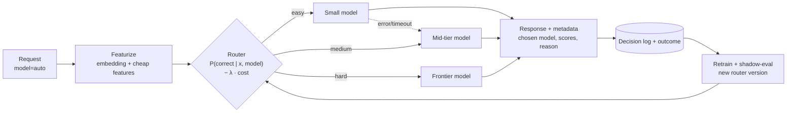

# 03 — Auto Routing: send each request to the cheapest model that will get it right

> **The sentence you want a reviewer to read:**
> "I built a router that picks a model per request. On a held-out set of XX prompts across K task types, it keeps XX% of the best model's quality at XX% of its cost, beats the static per-task-type baseline by X pts at equal cost, adds XX ms at p95, and runs as a drop-in `model="auto"` endpoint."

## What this project proves

- You think in **cost/quality/latency tradeoffs**, not "always use the biggest model".
- You apply ML basics correctly: proper splits, **strong baselines**, calibration, and out-of-distribution tests.
- You can turn a model into a **serving component** with fallbacks, logging, and retraining.

## Read this before you start

Recent research shows that simple baselines are **hard to beat**:

- A well-tuned **kNN over prompt embeddings** matches or beats complex learned routers across many tasks ([Li, 2025](https://arxiv.org/abs/2505.12601)).
- In a 14-model study, **assigning one fixed model per task type** captured most of the gains available from routing, and learned routers often failed to beat simply calling the strongest model ([Lee, 2026](https://arxiv.org/abs/2608.23023)). The same study found that **5.37% of model–question outcomes changed between two identical runs**.
- Across large benchmarks, routing does beat any single model, but a large gap to the oracle remains ([LLMRouterBench, 2026](https://arxiv.org/abs/2601.07206)).

So your project is only credible if you **beat these baselines honestly**, or show honestly that you didn't and explain why. A careful negative result with strong baselines still lands in pile two. A fancy router with no baselines doesn't.

---

## 1. Target architecture

## 2. Milestones

### M0 — Model pool and price table
- Pick **3–5 models** across tiers, all behind one OpenAI-compatible interface (LiteLLM): for example an 8B-class open-weights model, a mid-tier model, a frontier model, and optionally a reasoning model.
- Put prices per 1M input/output tokens in `config/models.yaml` **with the date you looked them up**. Prices change often.
- Compute cost from **actual token usage**, not the price list alone. Models produce very different output lengths (reasoning models especially), so the same prompt can cost very different amounts.

**Done when:** one function call sends a prompt to any model in the pool and returns `(output, input_tokens, output_tokens, cost, latency)`.

### M1 — The routing matrix (your dataset)
You need to know how **every model** does on **every prompt**. There are two ways to get there:

- **Fast start (recommended for iterating):** use precomputed outputs. [RouterBench](https://huggingface.co/datasets/withmartian/routerbench) has 405k+ outputs from 11 models on 7 tasks; [LLMRouterBench](https://arxiv.org/abs/2601.07206) has 400k+ instances from 21 datasets and 33 models. You can develop routers without paying for inference. The downside is that the models are older than your pool.
- **Your own matrix (required for the final evaluation):** 1,000–3,000 prompts across **5–8 task types** that match a realistic product, e.g. math ([GSM8K](https://huggingface.co/datasets/openai/gsm8k)), code ([MBPP](https://huggingface.co/datasets/google-research-datasets/mbpp)), knowledge/reasoning ([MMLU-Pro](https://huggingface.co/datasets/TIGER-Lab/MMLU-Pro)), extraction, summarization, and chit-chat. Run **every model on every prompt at least twice**.
  - Grade deterministically wherever possible (exact match, unit tests). For open-ended tasks, use an LLM judge **validated against your own labels** (see Project 02, M4).
  - Store it as Parquet with one row per (prompt_id, task_type, model, run, correct, input_tokens, output_tokens, cost, latency).
- **Measure label noise:** the % of (prompt, model) pairs that change between runs. Pick a label rule, e.g. correct only if it passed in both runs, or the mean over runs, and document it.
- **Splits:** train / val / test **by prompt**, plus an **OOD test**: one task type held out of training entirely.

**Done when:** `data/matrix.parquet` exists, and the README states the noise rate and split sizes.

### M2 — Baselines (non-negotiable)
Compute quality and cost on the test set for each of these:

| Baseline | What it is |
|---|---|
| Always-cheapest | Lower bound on cost |
| **Always-best** | The single model with the highest test quality |
| Random at matched cost | Random routing with the same cost as your router |
| **Static task-type table** | Pick one best-value model per task type on train. Needs a task-type classifier at inference, so count its cost too |
| **Oracle** | The cheapest model that got each prompt right. The ceiling, which no router reaches |

**Done when:** all five are points on one cost–quality plot.

### M3 — Routers (build at least two)
1. **kNN router**: embed the prompt, find the k nearest training prompts, and estimate `P(correct | model)` from how each model did on them. Tune k and the distance weighting on val.
2. **Learned router**: one model per LLM (or a multi-output model) predicting `P(correct | x, model)`, e.g. logistic regression or a small MLP on embeddings plus cheap features (length, code present, language, question type). Optionally fine-tune a small encoder.
3. **Cascade** *(optional third)*: call the cheap model first and escalate if a check fails. The check can be a verifier, unit tests, schema validation, self-consistency, or a logprob threshold. Count the cost and latency of the wasted first call.
4. *(Optional comparison)* RouteLLM's routers or methods from the [LLMRouter](https://github.com/ulab-uiuc/LLMRouter) library.

**Decision rule:** choose `argmax_m  P̂(correct | x, m) − λ · Ê[cost | x, m]`. Sweep λ to trace a **cost–quality curve**, and expose λ presets in the API (`auto:cheap`, `auto:balanced`, `auto:quality`).

**Done when:** each router is a curve on the same plot as the baselines.

### M4 — Evaluate honestly
- **Hero plot**: test-set cost vs quality, with every router as a curve and every baseline as a point.
- **Headline numbers**:
  - Cost savings at quality parity, e.g. "at ≥ 98% of always-best quality, cost is XX% lower".
  - Quality at cost parity, e.g. "at the same cost as the static table, quality is X pts higher".
  - **Oracle gap closed**: `(q_router − q_always_best) / (q_oracle − q_always_best)` at matched cost.
  - For a two-model setup, also report RouteLLM's **APGR** (average performance gap recovered) so you can compare with published numbers ([RouteLLM](https://arxiv.org/abs/2406.18665)).
- **Per-task-type breakdown**: where the router sends each type, and where it loses to the static table.
- **OOD test**: performance on the held-out task type. Most routers degrade here. Show by how much.
- **Calibration**: a reliability diagram for `P̂(correct)`. A miscalibrated router makes bad cost tradeoffs.
- **Overhead**: router p50/p95 latency and cost per 1k routing decisions (embedding calls count).
- **Significance**: bootstrap CIs over prompts, compared against your label-noise rate from M1.

**Done when:** the README has the hero plot and a results table with CIs.

### M5 — Serve it
- An OpenAI-compatible endpoint where `model="auto"` (or a λ preset) routes the request. Every response includes metadata: `chosen_model`, predicted scores, router version.
- **Fallback**: if the chosen model errors or times out, try the next-best model.
- **Decision log**: request features, choice, cost, latency, and any outcome signal (judge score, user feedback, downstream success).
- **Retraining**: a job that retrains the router from new labeled outcomes, writes a new router version, **shadow-evaluates** it on logged traffic, and only then switches.
- **Cold start**: document how you add a **new model** to the pool. Running it on a calibration subset of prompts is enough for kNN.

**Done when:** a demo script sends 50 mixed prompts through `model="auto"` and prints the chosen models, total cost, and quality against always-best.

---

## 3. What to measure

| Metric | Definition |
|---|---|
| Quality | Test accuracy or pass rate (judge pass rate for open-ended tasks) |
| Cost | Total $ on the test set from actual token usage, also as $/1k requests |
| Cost savings at parity | % cost reduction vs always-best at ≥ X% of its quality |
| Quality at parity | Quality gain vs the static task-type table at equal cost |
| Oracle gap closed | Share of the always-best → oracle gap recovered at matched cost |
| APGR | RouteLLM's metric, for two-model setups |
| OOD quality | Quality on the held-out task type |
| Calibration | Expected calibration error (ECE) of `P̂(correct)` |
| Router overhead | p50/p95 added latency; $ per 1k decisions |
| Routing mix | % of traffic per model, per task type |

## 4. Artifacts to commit

- [ ] `README.md` from the [template](README_TEMPLATE.md), with the hero plot above the fold
- [ ] `config/models.yaml` (dated prices) and `data/` (or a script that rebuilds the matrix)
- [ ] `routers/` with each router behind the same interface: `route(prompt, lam) -> model`
- [ ] `notebooks/` or `reports/` with the plots, regenerated by `make report`
- [ ] Serving code for the `model="auto"` endpoint with a demo script
- [ ] `docs/adding-a-model.md` describing the cold-start procedure

## 5. Stretch goals

- **Latency-aware routing**: optimize for quality under a p95 latency SLO instead of cost.
- **Online learning**: a contextual bandit (e.g. LinUCB or Thompson sampling) that updates from live feedback, compared with batch retraining.
- **Submit to [RouterArena](https://arxiv.org/abs/2510.00202)**, an open platform for comparing routers, and report where you rank.
- **Route to your own fine-tune**: put a small fine-tuned model in the pool and show the share of traffic it handles and what that saves.
- **Agent-step routing**: route each step of the Project 02 agent (planning vs tool-arg filling vs final answer) separately, and measure the end-to-end task success/cost tradeoff.

## 6. Red flags (these put you back in pile one)

- A keyword `if/else` called a "router", with no evaluation.
- Results reported on training prompts, or no OOD test.
- No **oracle** or **static task-type** baseline.
- A frontier LLM used as the router whose cost and latency aren't counted.
- Costs computed from list prices × assumed lengths instead of actual usage, or a price table with no date.
- A single run per (prompt, model), with label noise ignored.

## 7. Interview questions you'll get

1. **"Why not just always use the best model?"** Show the curve. Then explain when that's actually the right call (low volume, high cost of errors).
2. **"How do you add a new model to the pool?"** Run it on a calibration set. kNN needs only the new labels; a per-model classifier needs one new head.
3. **"Your router loses to the static table on math. Why?"** Coarse embeddings for that task type, label noise, or too little data. Show the per-type breakdown and say what you'd do about it.
4. **"Cascade or upfront routing?"** A cascade gets a real signal from the cheap model's attempt but pays for that call and adds latency. Upfront routing is faster but blind. It depends on how good your verifier is.
5. **"How does label noise affect training?"** Noisy labels cap achievable accuracy. Mitigate by using repeated runs, soft labels, and reporting the noise rate.
6. **"How would you know the router is degrading in production?"** Monitor quality per routed model, the routing-mix drift, and run shadow evals on sampled traffic.

## 8. Suggested stack (vendor-neutral)

| Layer | Default | Alternatives |
|---|---|---|
| Model access | [LiteLLM](https://github.com/BerriAI/litellm) | OpenRouter, direct SDKs |
| Embeddings | An open sentence-embedding model via `sentence-transformers` | A provider embedding API (count its cost) |
| Data | Polars + Parquet | pandas |
| Routers | scikit-learn (kNN, logistic regression), PyTorch (MLP) | Fine-tuned small encoder |
| Reference implementations | [RouteLLM](https://github.com/lm-sys/RouteLLM), [LLMRouter](https://github.com/ulab-uiuc/LLMRouter) | |
| Serving | FastAPI (OpenAI-compatible schema) | LiteLLM proxy custom routing hook |
| Plots | matplotlib | plotly |

Further reading for this project is in [RESOURCES.md](../../RESOURCES.md#auto-routing).
