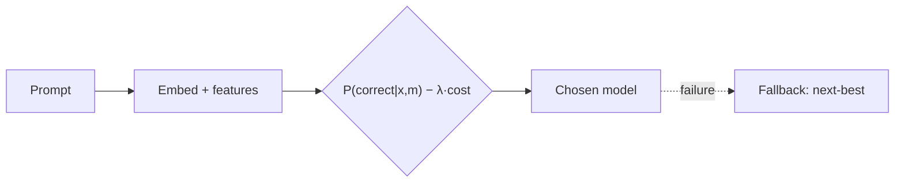

<!--
  README template for Project 03: Auto Routing.
  Copy this into your repo as README.md on day one and fill it in as you build.
  Replace every <placeholder> and XX. Delete these comments when you're done.
  Rule: every number needs a baseline, a sample size, and a note on how you measured it.
-->

# <Router name>: cost-aware LLM routing

> A router that sends each request to the cheapest model likely to answer it correctly. It runs as a drop-in OpenAI-compatible endpoint (`model="auto"`).

## Results

<!-- Hero image: cost vs quality on the test set. Routers as curves, baselines as points. -->


Test set: XX prompts, K task types, M models. Prices as of <YYYY-MM-DD>.

| Policy | Quality (95% CI) | Cost / 1k requests | vs always-best |
|---|---|---|---|
| Always-cheapest | XX% | $X.XX | −XX pts, −XX% cost |
| Always-best (<model>) | XX% | $X.XX | n/a |
| Static task-type table | XX% | $X.XX | |
| **kNN router (λ = X)** | **XX%** | **$X.XX** | **−X pts, −XX% cost** |
| Learned router (λ = X) | XX% | $X.XX | |
| Oracle (upper bound) | XX% | $X.XX | |

- **Headline:** at ≥ 98% of always-best quality, the router costs XX% less.
- **Oracle gap closed:** XX% at matched cost.
- **OOD (held-out task type: <type>):** XX% vs XX% for always-best.
- **Overhead:** +XX ms p95, $X.XX per 1k routing decisions.
- **Label noise:** X.X% of (prompt, model) outcomes changed between identical runs. Differences below that are treated as noise.

## Where requests go

| Task type | Small | Mid | Frontier | Router vs static table |
|---|---|---|---|---|
| Math | XX% | XX% | XX% | +X pts |
| Code | | | | |
| Extraction | | | | |
| ... | | | | |

## How it works



1. **Routing matrix:** every model ran every prompt twice → `data/matrix.parquet` (XX rows).
2. **Router:** <kNN with k = XX / logistic regression on embeddings + features> predicts `P(correct)` per model.
3. **Decision:** maximize predicted quality − λ × expected cost. λ presets: `auto:cheap`, `auto:balanced`, `auto:quality`.
4. **Serving:** each response includes `chosen_model`, scores, and `router_version`. Every decision is logged for retraining.

## How I measured

- **Data:** <sources>, split train/val/test = XX/XX/XX by prompt; <task type> held out as OOD.
- **Grading:** exact match / unit tests for <types>; an LLM judge for <types>, validated against XX human labels (agreement XX%).
- **Cost:** actual input/output tokens × the dated price table in [`config/models.yaml`](config/models.yaml).
- **CIs:** bootstrap over prompts, 1,000 resamples.

## What broke (and what I learned)

1. **<e.g. My learned router lost to kNN.>** <Why, and what the evidence was.>
2. **<e.g. Reasoning model costs were 4× my estimate.>** <...>

## Key decisions and tradeoffs

| Decision | Alternatives | Why |
|---|---|---|
| kNN as the primary router | MLP, BERT classifier | <e.g. matched quality with no training; trivial cold start> |
| Upfront routing | Cascade | <your reason, with numbers> |

## Run it

```bash
git clone https://github.com/<you>/<repo> && cd <repo>
cp .env.example .env
make matrix        # build or download the routing matrix (cached)
make train         # fit routers
make report        # plots + tables → docs/
make serve         # OpenAI-compatible endpoint on :8000
python scripts/demo.py   # 50 mixed prompts through model="auto"
```

## Adding a new model

See [`docs/adding-a-model.md`](docs/adding-a-model.md): run it on the XX-prompt calibration set, add the rows to the matrix, refit, and shadow-evaluate.

## Limitations and next steps

- <e.g. "Matrix has XX prompts per task type; kNN density is thin for <type>.">
- <e.g. "No latency-aware routing yet.">
